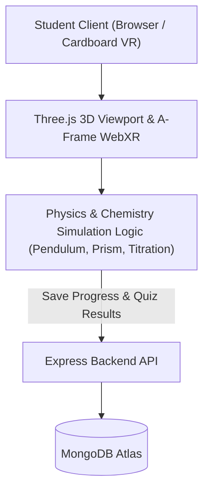

# Virtual Science Lab (Skill India VR)

Browser-based 3D and WebXR interactive physics and chemistry laboratory for resource-constrained schools across India.

[Live demo](TODO: owner to add) | [License](LICENSE)

  <!-- TODO: owner to add -->

---

## Features
- **3D Interactive Physics & Chemistry:** Real-time simulations including Simple Pendulum harmonic motion, Prism light refraction, and Acid-Base Titration indicators.
- **WebXR / VR Mode:** A-Frame headset immersion mode allowing hands-on spatial manipulation on mobile browsers and Cardboard headsets without specialized hardware.
- **Low-Bandwidth Optimization:** Pure client-side Three.js render pipeline designed to run smoothly on basic mobile devices over slow 3G/4G connections.
- **Student Progress Tracking:** Tracks experiment steps completed, safety warnings triggered, and observation log submissions.
- **Teacher Governance Panel:** Administrative dashboard to review classroom experiment logs, student quiz completions, and performance analytics.

## Tech Stack
- **Frontend:** HTML5, CSS3, Modern JavaScript (ES6+), Three.js, A-Frame (WebXR)
- **Backend:** Node.js, Express, REST APIs
- **Database:** MongoDB (Mongoose schemas for Users, Experiments, Progress)
- **Deployment:** Vercel (Frontend), Railway / Render (Backend)

## Architecture



## Getting Started

### Prerequisites
- Node.js 18+
- MongoDB (local or Atlas cluster)

### Setup
1. Clone the repository:
   ```bash
   git clone https://github.com/yashpatadiya1724-cmyk/virtual-science-lab.git
   cd virtual-science-lab
   ```

2. Copy environment template:
   ```bash
   cp .env.example backend/.env
   ```

3. Install backend dependencies:
   ```bash
   cd backend
   npm install
   ```

4. Start the backend API:
   ```bash
   npm start
   ```

5. Open the frontend:
   ```bash
   npx serve frontend
   ```

## Environment Variables

| Variable | Purpose |
|---|---|
| `PORT` | Backend HTTP API server listening port (default: `5000`) |
| `NODE_ENV` | Runtime environment (`development` / `production`) |
| `MONGODB_URI` | MongoDB database connection URI |
| `JWT_SECRET` | Secret key for signing student and teacher JWT session tokens |
| `SESSION_SECRET` | Secret key for express session encryption |
| `CLIENT_URL` | Allowed client origin for CORS requests (default: `http://localhost:3000`) |

## Security and Privacy
- **Tenancy Scoping:** Student experiment progress and quiz scores are strictly scoped by user authentication tokens.
- **Client-Side Rendering:** Simulation logic executes client-side via procedural Three.js geometry, avoiding heavy 3D asset downloads and server-side compute.
- **Known Limitations:** WebXR stereoscopic mode requires WebGL-enabled mobile browsers; older low-end devices render in standard interactive 2D canvas mode.

## Roadmap
- [x] Simple Pendulum, Prism Optics & Acid-Base Titration simulations
- [x] WebXR stereoscopic VR rendering
- [x] Student progress tracking & teacher admin console
- [ ] Vernier Caliper and Screw Gauge micro-precision simulations
- [ ] Offline PWA caching for rural schools with intermittent connectivity

## What I Learned
- Procedural geometry and mathematical shaders in Three.js provide a significantly lighter, faster experience on budget Android phones than importing bulky pre-modeled 3D GLTF files.
- Designing educational simulations for rural classrooms requires graceful fallback: if WebXR headsets aren't available, standard touch and mouse controls must deliver equivalent educational value.

## Author
Yash Patadiya: [LinkedIn](https://www.linkedin.com/in/yash-patadiya-973161272/)

## License
MIT
